<div align="center">

# 🌱 TechTitan-AgriSphere

### KrishiMitra ONE — A Smart Agriculture Management & DevOps Platform

**Plan smarter. Track better. Grow with confidence.**

A responsive, photo-rich agricultural operations website that brings crop discovery, farm planning, soil records, crop-health journaling, harvest management, weather information, market preparation, and farm finances into one connected experience.

[](https://github.com/anisaskazi/TechTitan-AgriSphere/actions/workflows/ci.yml)


**[Source Code](https://github.com/anisaskazi/TechTitan-AgriSphere)** · **[CI Workflow](https://github.com/anisaskazi/TechTitan-AgriSphere/actions)** · **[Issues](https://github.com/anisaskazi/TechTitan-AgriSphere/issues)**

</div>

> **Project status:** Educational / supervised pilot frontend. The application is implemented and has been run locally and in Docker, but it is **not yet a production-ready farmer service**. Some features are rule-based or locally stored, not AI-powered or backed by a secure cloud database. This distinction is intentional and documented throughout.

---

## 📑 Contents

1. [Executive summary](#-executive-summary)
2. [Problem statement and objectives](#-problem-statement-and-objectives)
3. [Implemented features](#-implemented-features)
4. [Technology stack](#-technology-stack)
5. [System architecture](#-system-architecture)
6. [Project structure](#-project-structure)
7. [Getting started](#-getting-started)
8. [Docker containerization](#-docker-containerization)
9. [Continuous integration with GitHub Actions](#-continuous-integration-with-github-actions)
10. [Testing and verification](#-testing-and-verification)
11. [Screenshot evidence and demonstration](#-screenshot-evidence-and-demonstration) — includes 13 newly supplied screenshots
12. [Five meaningful changes and authentic Git history](#-five-meaningful-changes-and-authentic-git-history)
13. [Academic ISE-2 rubric and submission checklist](#-academic-ise-2-rubric-and-submission-checklist)
14. [Deployment](#-deployment)
15. [Git and version-control workflow](#-git-and-version-control-workflow)
16. [Security, data handling, and limitations](#-security-data-handling-and-limitations)
17. [Production roadmap](#-production-roadmap)
18. [Academic learning outcomes](#-academic-learning-outcomes)
19. [Repository maintainer](#-repository-maintainer)
20. [Conclusion](#-conclusion)

---

## 🎯 Executive summary

**TechTitan-AgriSphere** is the GitHub project for **KrishiMitra ONE**, a unified agricultural web application designed to make everyday farm management more organized and accessible. Instead of switching between separate notebooks, spreadsheets, websites, and informal records, a farmer can explore crops and maintain a consistent set of farm records in one interface.

The current release provides **18 responsive screens** and connected workflows spanning soil observations, crop plans, daily work, crop-health notes, harvest records, buyer-quote comparisons, storage, and finances. A weather module retrieves forecasts through **Open-Meteo** when internet connectivity is available.

It also demonstrates real-world **DevOps fundamentals**: source control through Git and GitHub, automated verification through GitHub Actions, a repeatable static build, and Docker containerization with Nginx.

**Recorded project evidence (25 October 2026):**

| Check | Observed result |
| --- | --- |
| GitHub repository | Initial source pushed to `main` (commit `15d1db4` visible in the supplied repository screenshot) |
| Automated tests | **46 passed, 0 failed** in the inspected CI run; independently reproduced using the supplied source package |
| Static build | `npm run build` succeeded in CI and was independently reproduced from the supplied source package; output created in `dist/` |
| Docker image | `techtitan-agrisphere` built successfully on the local machine |
| Container | `techtitan-agrisphere` reported **Up (healthy)** |
| Local container access | Port mapping `8081:80` |
| Public production deployment | Not yet demonstrated |

> The CI and Docker checks above document the successful runs observed during development. They are not a claim of independent security auditing, agronomic validation, or public production deployment.

## 🌍 Problem statement and objectives

### The problem

Farmers often manage important information across disconnected channels: soil reports, sowing dates, irrigation logs, crop observations, expenses, buyer quotations, and weather forecasts. Disconnected records make it harder to review decisions or understand the full farm cycle.

### Project objectives

- Design an intuitive, responsive interface that emphasizes readable information and agricultural photography.
- Bring common farm operations into a single navigable application.
- Support structured recording of soil tests, field work, crop plans, harvests, costs, and sales-related details.
- Offer explainable **rule-based** crop-fit comparisons for educational planning.
- Include internet-enabled weather information and links to official market or government resources.
- Demonstrate disciplined development using Git, automated tests, build verification, Docker, and documentation.
- Clearly separate completed functionality from future AI/ML, cloud synchronization, and commercial features.

## ✨ Implemented features

| Module | What the current application does |
| --- | --- |
| 🏡 **Home** | Agricultural image-led landing page, responsive navigation, feature cards, and calls to action |
| 🌾 **Crop-fit advisor** | Compares catalogued crops using season, soil texture, broad water category, and soil-pH context; **rule-based, not a trained ML recommendation model** |
| 🌿 **Crop catalog** | **16 crop profiles** with search, category/season filters, sorting, favorites, and descriptive information |
| 🧺 **Market hub** | Browse product categories and prepare **private listing drafts**; no live buyer or payment integration |
| 🚜 **My Farm / Dashboard** | Record basic farm profile information such as location, area, country, units, and currency; view linked records |
| 🧪 **Soil records** | Store pH and N/P/K observations with reference information for comparing tests over time |
| 📅 **Crop planning** | Maintain sowing plans, plots, areas, dates, and growing stages |
| ✅ **Tasks and irrigation** | Record farm work, irrigation activity, due dates, and completion status |
| 🍃 **Crop health** | Keep crop photographs and symptom notes in a local journal; **no trained image-based disease diagnosis** |
| 🌽 **Harvest** | Record harvests and explore an **illustrative**, user-input yield scenario |
| 🤝 **Buyer quotes** | Compare manually entered offers and associated transport or other costs |
| 📦 **Storage** | Track storage batches, locations, and dispatch progress |
| 💰 **Finance** | Record income and expenses, select display currency, and access official scheme references |
| 🌦️ **Weather** | Search locations and request online forecasts via **Open-Meteo** |
| 📚 **Knowledge** | Read educational crop-management articles and field notes |
| 📊 **Reports and backup** | Review saved-record summaries, export/import JSON backups, and export financial CSV data |
| ℹ️ **About** | Explain the project, current limitations, and planned improvements |

The project's README describes **18 screens** overall; the table groups the main user-facing capabilities rather than claiming that each listed line is a separate route.

### Example connected farm workflow

1. Enter a farm profile and basic field information.
2. Record soil observations and compare possible crops.
3. Create a sowing plan and scheduled tasks.
4. Track irrigation and document crop-health observations.
5. Record harvest outcomes and compare buyer quotations.
6. Log storage or dispatch activity and farm finances.
7. Export a backup or review the accumulated records.

**Real-world value:** One place to organize decisions and retain farm records throughout the growing cycle. **Current scope:** personal/browser-local records for demonstration and supervised testing—not synchronized multi-user farm management.

## 🛠 Technology stack

| Layer | Technology / approach | Purpose |
| --- | --- | --- |
| User interface | HTML5, CSS3, JavaScript (ES modules) | Responsive screens and browser interactions |
| Application logic | JavaScript modules including `app.js`, `data.js`, and `logic.js` | Page behavior, catalog data, and business rules |
| Local persistence | Browser `localStorage` | Saving demo records on the current browser/device |
| Offline assets | Web app manifest and service worker | Caching selected static resources; not live API data |
| Weather | Open-Meteo web APIs | Location lookup and forecasts when online |
| Development | Node.js and npm scripts | Local serving, tests, and production build |
| Testing | Node.js built-in test runner | Automated application and configuration checks |
| Packaging | Docker multi-stage build | Reproducible production image |
| Web serving | Nginx | Serve the built static website inside the container |
| CI | GitHub Actions | Run tests, build, and output verification after pushes |
| Version control | Git and GitHub | Track authentic changes and collaboration history |
| Static deployment option | Netlify | Optional external hosting for the built `dist/` directory |

> **Not part of this release:** authenticated user accounts, server-side database, trained crop-disease classifier, verified live mandi-price ingestion, real payments, or cloud data synchronization.

## 🏗 System architecture

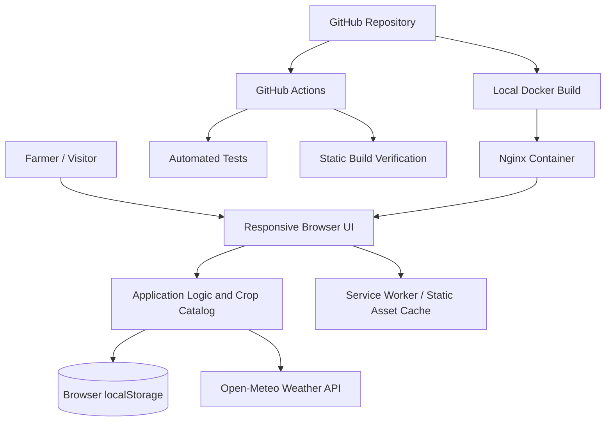

**Architecture notes:**

- **Application records are browser-local.** The Nginx container serves the frontend; it does not provide a cloud database or account service.
- **Open-Meteo requires network access** and its service terms apply.
- **Service-worker caching** may improve access to previously loaded static assets, but does not guarantee fresh forecasts or universal offline operation.
- **GitHub Actions verifies tests and build.** A successful CI check should not be interpreted as automatic public deployment.

## 🗂 Project structure

```text
KrishiMitra-ONE/
├── .github/
│   └── workflows/        # GitHub Actions CI configuration
├── assets/               # Agricultural images and interface assets
├── docs/                 # Project, farmer, and production-roadmap notes
├── scripts/
│   ├── serve.mjs          # Local development server
│   └── build.mjs          # Static build generator
├── tests/                 # Automated Node.js tests
├── screenshots/            # Embedded application, DevOps and external-reference screenshots
│   ├── homepage-hero.png
│   ├── eight-farming-workflows.png
│   ├── weather-forecast-kolhapur.png
│   ├── docker-container-running.png
│   └── ...                  # Other verified screenshot files
├── .dockerignore
├── .gitignore
├── Dockerfile             # Multi-stage build and Nginx packaging
├── compose.yaml          # Optional container orchestration setup
├── nginx.conf             # Nginx site configuration
├── index.html             # Application entry point
├── app.js                 # Application UI and interactions
├── data.js                # Crop/reference catalogue data
├── logic.js               # Shared calculations and business logic
├── styles.css             # Responsive styling
├── manifest.webmanifest   # Web app metadata
├── sw.js                  # Service worker
├── netlify.toml           # Static hosting configuration
├── package.json          # npm scripts
├── START_HERE.md          # Local setup instructions
├── HOSTING_GUIDE.txt      # Hosting notes
└── README.md
```

`dist/` is generated by the build command and is the deployable static output. Whether it appears in your local Explorer depends on whether you have already built the project.

## 🚀 Getting started

### Prerequisites

- Windows, macOS, or Linux; a modern web browser.
- **Node.js 18 or newer** (a currently supported LTS version is recommended).
- Git for source control.
- Docker Desktop or Docker Engine **only** if running the containerized version.

### Option A — Run the source locally

```bash
git clone https://github.com/anisaskazi/TechTitan-AgriSphere.git
cd TechTitan-AgriSphere
npm run dev
```

Open **http://localhost:4173** in your browser.

The provided source release uses npm scripts and has no third-party dependencies that must be installed to start the local server. If you modify `package.json` to add dependencies, run `npm install` first.

### Run the automated checks

```bash
npm test
npm run build
```

Expected successful build message in the verified release:

```text
Build successful: dist/
```

### Build output

After building, inspect the `dist/` directory. It contains the production-ready **static frontend assets** to be hosted by Nginx or a static hosting provider.

## 🐳 Docker containerization

Docker makes the website easier to package, run, and demonstrate consistently. The project's Dockerfile uses a **multi-stage image**: Node builds the frontend, then Nginx serves the resulting static files.

### 1. Build the Docker image

Run this in the folder containing `Dockerfile`:

```bash
docker build -t techtitan-agrisphere .
```

### 2. Run the container

```bash
docker run -d --name techtitan-agrisphere -p 8081:80 techtitan-agrisphere
```

Open **http://localhost:8081**.

> Port `8081` was chosen because `8080` was unavailable on the test computer. If `8081` is also in use, select a free host port such as `8082` using `-p 8082:80`.

### 3. Verify the container

```bash
docker ps
```

The verified local run showed:

```text
IMAGE                  STATUS             PORTS                  NAMES
techtitan-agrisphere   Up ... (healthy)   0.0.0.0:8081->80/tcp  techtitan-agrisphere
```

Container IDs and elapsed time vary on every machine.

### 4. Inspect logs and manage the container

```bash
# Inspect container output
docker logs techtitan-agrisphere

# Stop the application
docker stop techtitan-agrisphere

# Remove the stopped container
docker rm techtitan-agrisphere
```

**Important:** Running the container at `localhost:8081` serves the application **only on the development computer** (or a reachable local network when explicitly configured). It does not create a public website.

## 🔄 Continuous integration with GitHub Actions

The repository includes a GitHub Actions workflow named **KrishiMitra CI**. In the verified run, it completed a `test-and-build` job successfully after the first push to `main`.

### CI flow

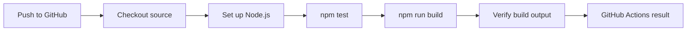

### What the workflow verifies

| Stage | Evidence from inspected run |
| --- | --- |
| Source checkout | Completed |
| Node.js setup | Completed |
| `npm test` | **46 tests passed; 0 failed** |
| `npm run build` | Completed successfully |
| Build output verification | Completed |
| Overall job | **Success** |

**CI status:** [Open the GitHub Actions page](https://github.com/anisaskazi/TechTitan-AgriSphere/actions).

**Scope distinction:** This CI workflow validates the application tests and static build. The **Docker build and healthy container** were separately verified **locally**. Do not claim CI performs Docker-image validation unless a Docker build step is actually added to the workflow and passes.

## 🧪 Testing and verification

The current project includes automated tests for application data, business rules, page/configuration structure, and safe handling of selected inputs. The inspected GitHub Actions logs reported the following successful examples:

- Farm record collections and default profile behavior.
- Multiple-country and currency options.
- HTML output escaping and input handling.
- Crop catalog entries and unique crop IDs.
- Crop-fit and soil-pH-related rules.
- Yield-estimate calculations and missing-field handling.
- Buyer quote totals and cost deductions.
- Responsive entry-point and navigation checks.
- Presence of CI and multi-stage Docker configuration.
- Properly labelled prototype limitations.

**Recorded automated test result:** **46 passed · 0 failed · 0 skipped**. These 46 tests also passed when the supplied source ZIP was tested in a clean local working directory.

### Suggested manual acceptance checklist

- [ ] Homepage loads at `http://localhost:4173` in local development.
- [ ] Docker-served homepage loads at `http://localhost:8081`.
- [ ] Navigation works on desktop and mobile viewports.
- [ ] Crop catalog search, filters, and favorites work.
- [ ] Farm profile and records survive a normal page refresh in the same browser.
- [ ] Soil, crop-planning, and task forms save and display records.
- [ ] Backup export/import is tested with **non-sensitive sample data**.
- [ ] Weather displays online results or a clear failure message.
- [ ] `npm test` completes without failures.
- [ ] `npm run build` generates `dist/`.
- [ ] GitHub Actions shows a successful run for the latest pushed commit.

> Mark manual checklist items complete **only after personally checking them**; automated tests alone do not prove every browser interaction.

## 📸 Screenshot evidence and demonstration

The images below are **real screenshots supplied during development**, not fabricated Git logs or mock CI output. The supplied screenshots demonstrate the initial repository, CI tests and build, a local Docker image build, and a healthy running container. The application image is a view of the real browser interface. Image paths are **relative to this README**, so the `screenshots/` folder must be uploaded together with the README.

### Interface gallery — screenshots of the project itself

The following images illustrate the agricultural website design and its farm workspace. They are **interface previews, not evidence of five separate Git commits**.

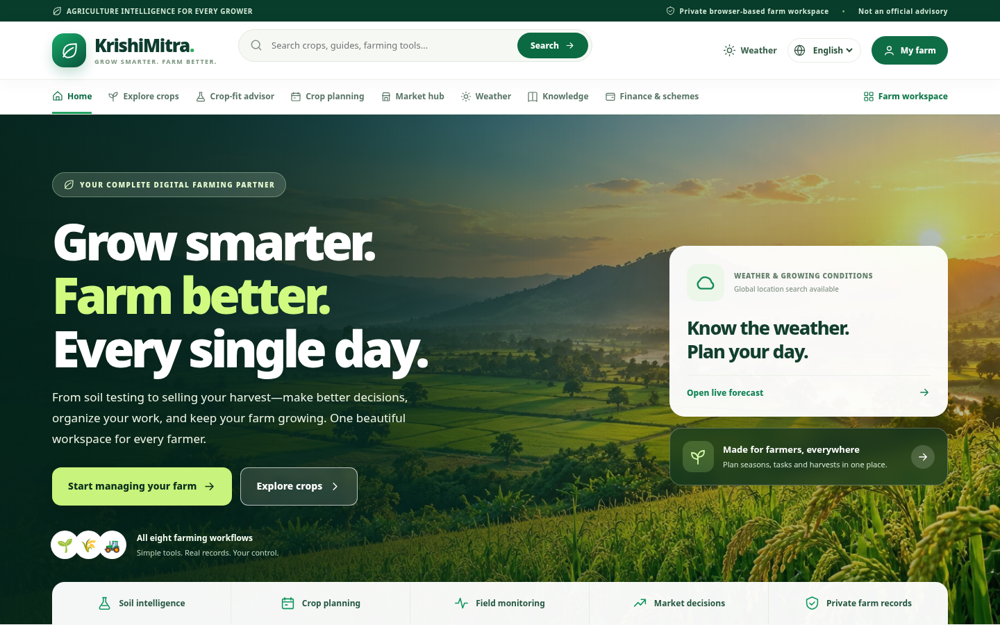

*Interface preview A — KrishiMitra ONE homepage with agricultural imagery, navigation and calls to action.*

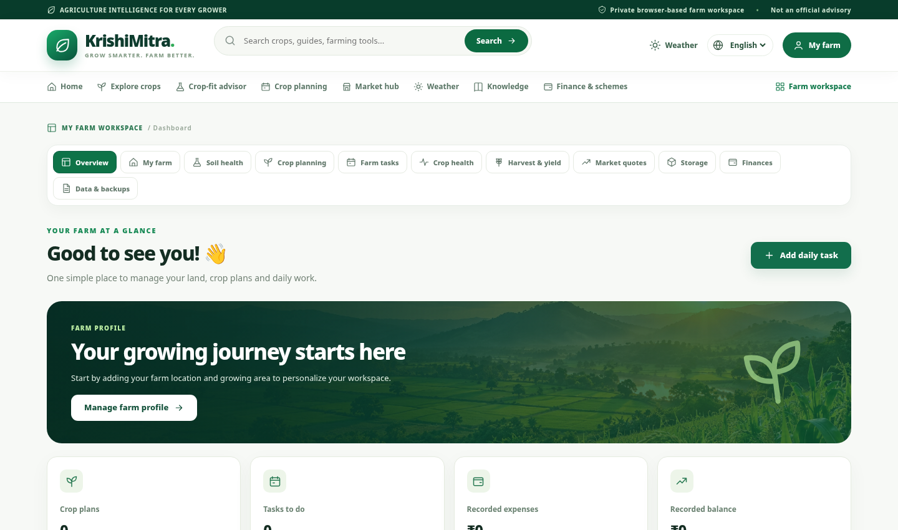

*Interface preview B — Farm dashboard with crop planning, soil health, tasks, finance and other farming tools.*

### 1. Working agricultural web application

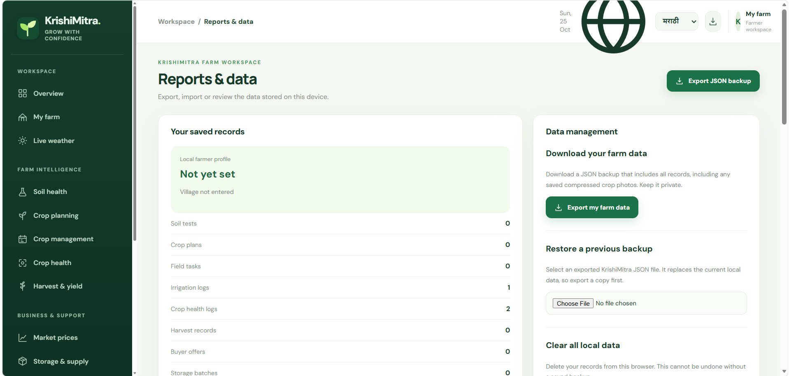

*Figure 1 — Browser screenshot of the Reports & Data module, demonstrating a farmer-facing application screen and export / record-management interface. This is not evidence of a separate Git commit.*

### 2. Organized GitHub source repository

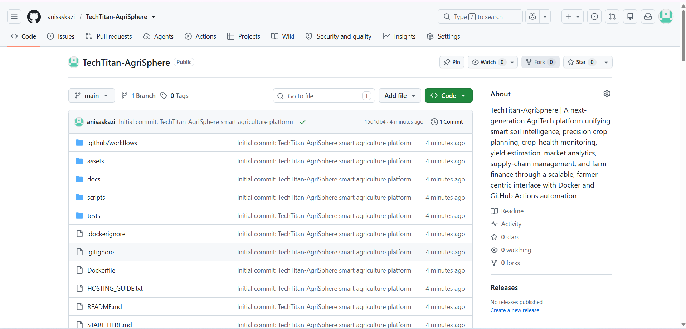

*Figure 2 — GitHub repository `anisaskazi/TechTitan-AgriSphere` showing the initial source tree, `main` branch, and commit history entry.*

### 3. Successful GitHub Actions execution

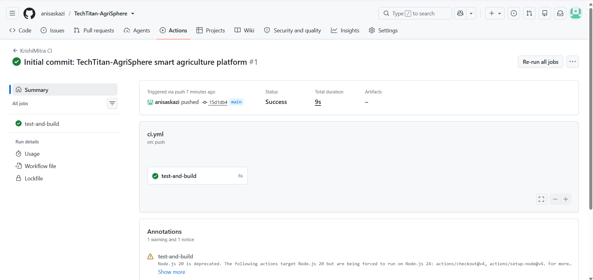

*Figure 3 — Successful workflow result for the initial commit.*

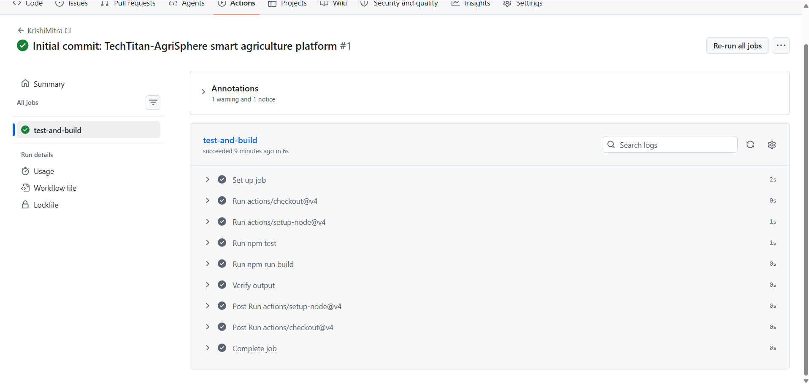

*Figure 4 — The `test-and-build` job includes source checkout, Node.js setup, automated tests, build, and output verification.*

### 4. Automated test execution — 46 passing tests

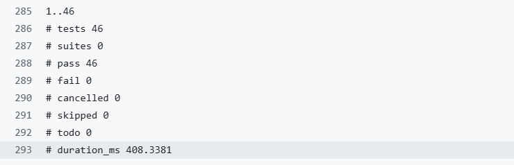

*Figure 5 — Actual Node.js test output showing `tests 46`, `pass 46`, `fail 0`.*

### 5. Production static build

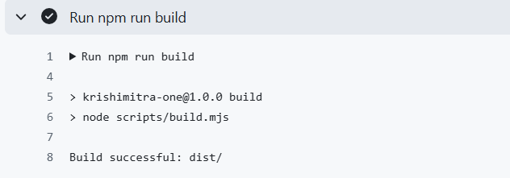

*Figure 6 — Actual GitHub Actions step: `npm run build` completed and reported `Build successful: dist/`.*

### 6. Docker image build

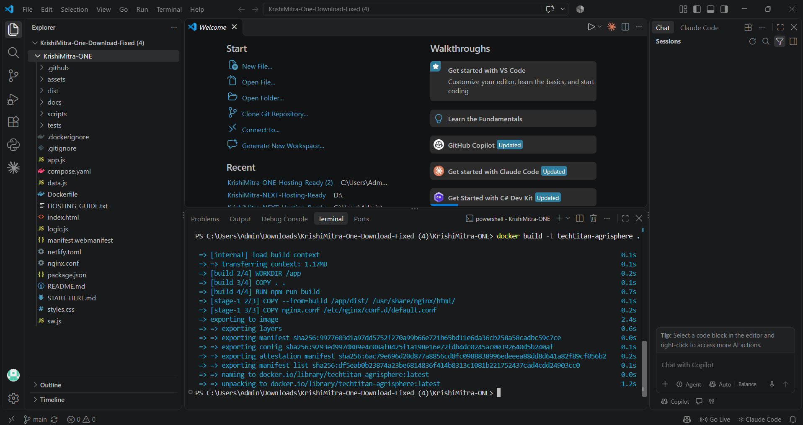

*Figure 7 — VS Code terminal output from building the `techtitan-agrisphere` Docker image using the multi-stage Dockerfile.*

### 7. Docker running container and health check

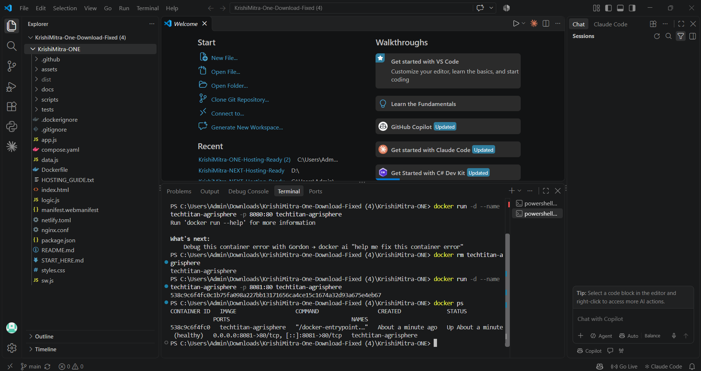

*Figure 8 — Actual `docker ps` screenshot: the `techtitan-agrisphere` image is running as container `techtitan-agrisphere` with healthy status and host port `8081` mapped to container port `80`.*

### 8. Extended website walkthrough — actual interface screenshots (new)

The following **nine additional screenshots** show different pages and sections of the user's working **KrishiMitra ONE** browser interface. These are views of the current website, **not before/after proof of separate commits**. Each screenshot is stored in the `screenshots/` folder using a simple descriptive filename.

#### 8.1 Homepage — smart agriculture landing page

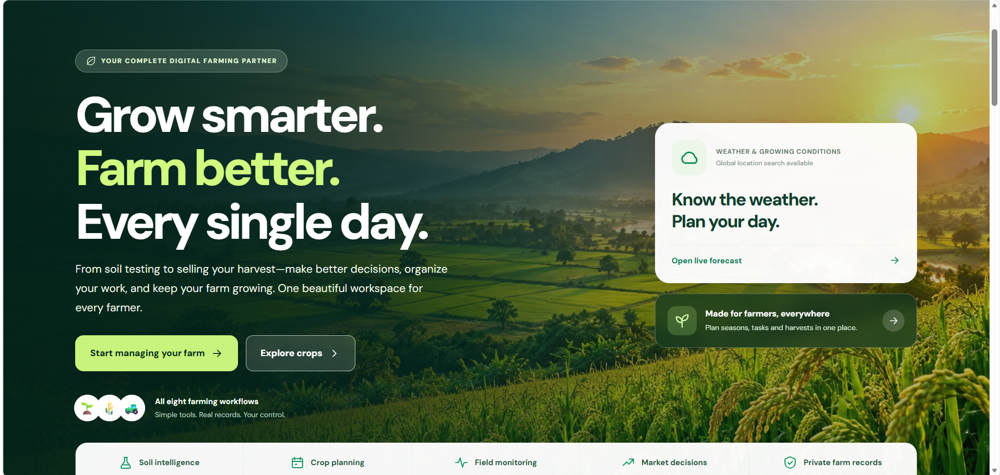

*Figure 9 — Main homepage hero: agricultural landscape, “Grow smarter. Farm better.” message, weather callout, and entry points into the farmer workspace.*

#### 8.2 Eight connected farming workflows

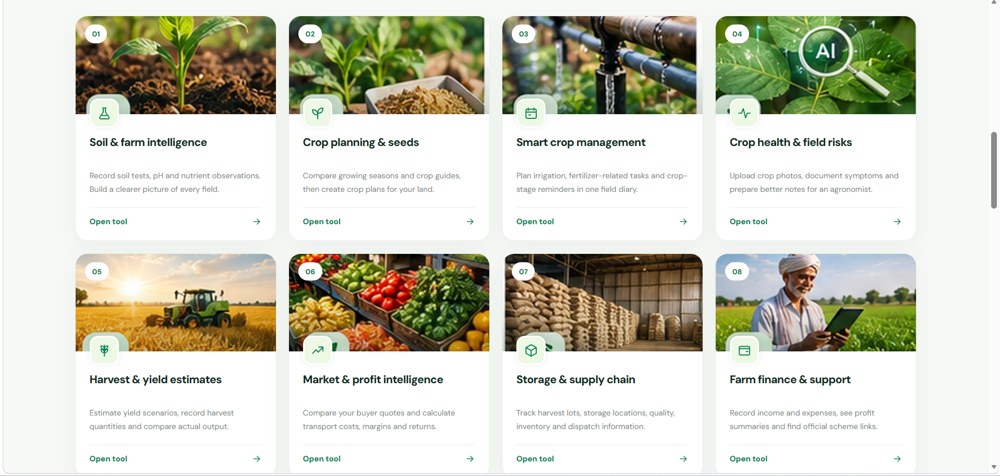

*Figure 10 — Feature overview cards for soil intelligence, crop planning, farm management, crop health, harvest, market comparisons, storage, and finance.*

#### 8.3 Farm workspace and recorded activity

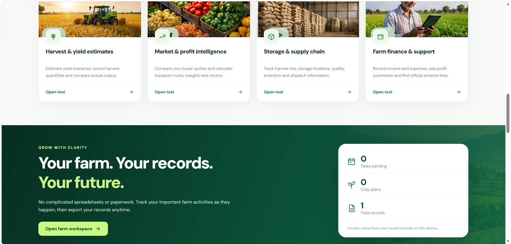

*Figure 11 — Farmer workspace overview showing the saved-data counters for tasks, crop plans, and field records. Counts reflect the current browser's sample records, not cloud-synchronized data.*

#### 8.4 Crop discovery and catalogued crop profiles

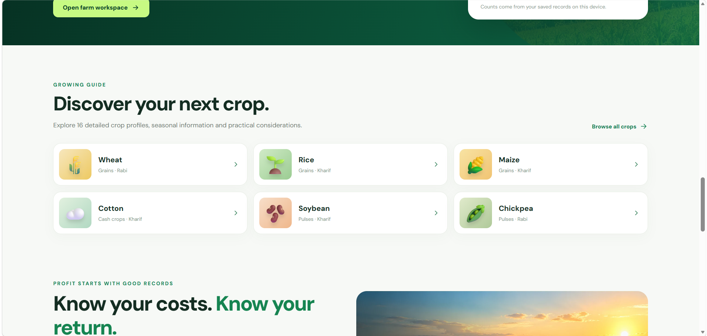

*Figure 12 — Crop discovery section displaying selected entries from the 16-profile crop catalogue and their season categories.*

#### 8.5 Farm expenses, buyer quotations and returns

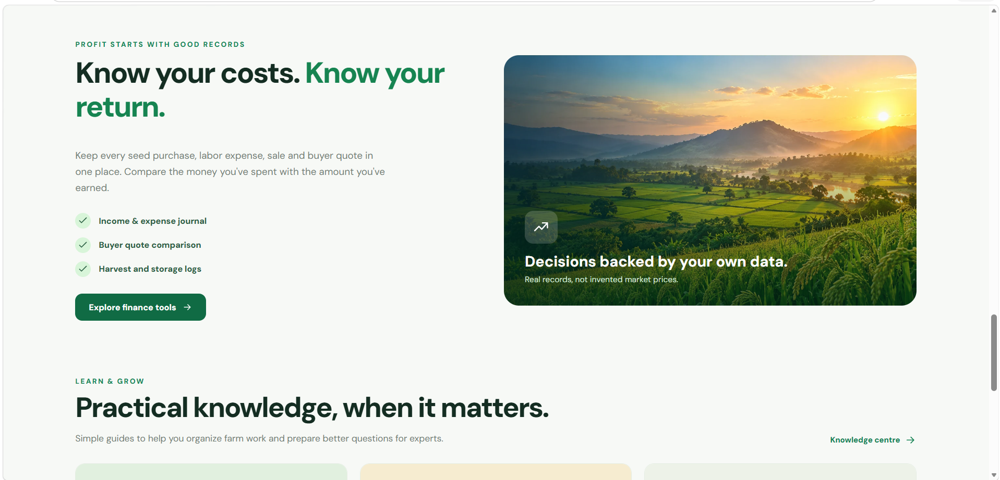

*Figure 13 — Finance-oriented presentation explaining income and expense journaling, buyer quote comparisons, and harvest or storage record management.*

#### 8.6 Practical agriculture knowledge articles

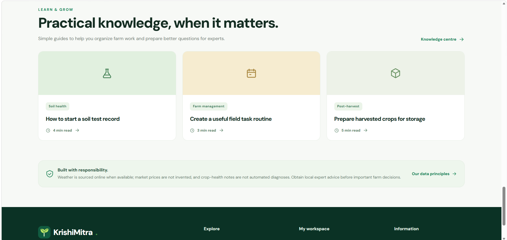

*Figure 14 — Knowledge centre with illustrated guides for soil-test records, field task routines, and post-harvest storage preparation.*

#### 8.7 Weather lookup with a multi-day forecast

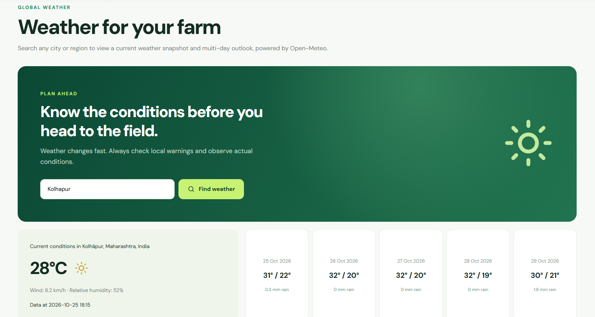

*Figure 15 — Weather module showing the Kolhapur search example, current conditions and multi-day outlook sourced from Open-Meteo. The values are a historical screenshot from 25 October 2026, not today's live forecast.*

#### 8.8 Market hub and produce categories

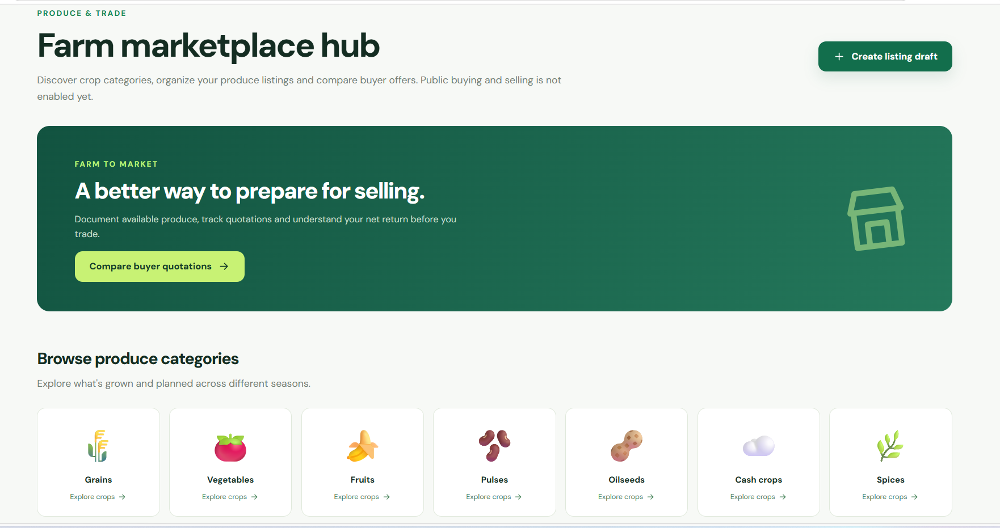

*Figure 16 — Marketplace hub with “Create listing draft,” buyer quotation access, and produce categories. The current application **does not support public buying, selling or payment processing**.*

#### 8.9 Trusted agricultural information links

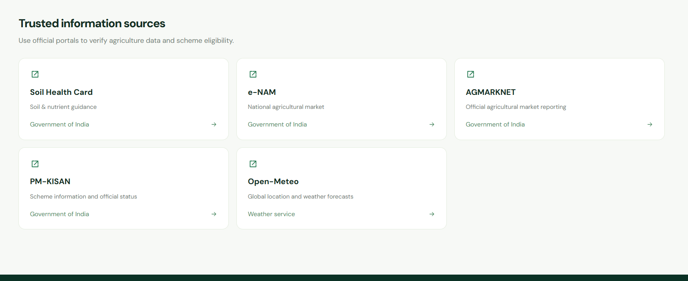

*Figure 17 — In-app directory of official agriculture portals and the Open-Meteo weather source for independent verification and further reading.*

### 9. Screenshots of external information sources (references only)

The next **four screenshots are of third-party official websites** visited for reference. They demonstrate which information sources a farmer may consult; **they are not part of the KrishiMitra ONE interface, are not proof of a direct API integration, and should not be counted as five separately developed website changes**. Their logos, content and trademarks remain with their respective owners.

#### 9.1 Government of India — Soil Health Card portal

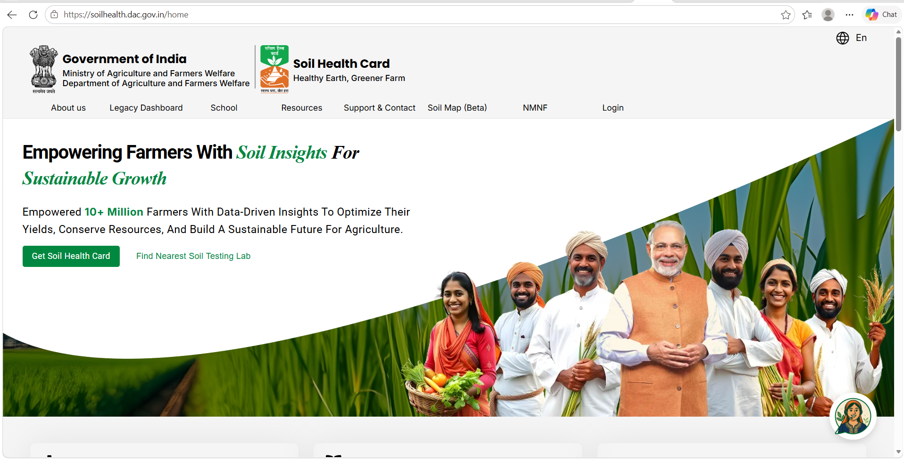

*Figure 18 — External reference: [Soil Health Card](https://soilhealth.dac.gov.in/home), the Government of India portal for soil-health resources.*

#### 9.2 e-NAM — National Agriculture Market

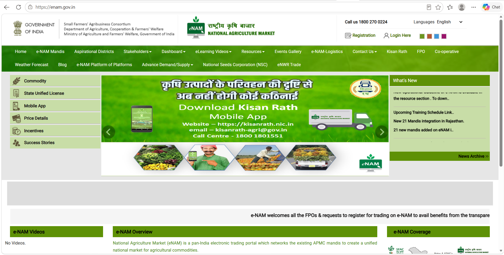

*Figure 19 — External reference: [e-NAM](https://enam.gov.in/), the national agricultural market portal.*

#### 9.3 AGMARKNET — agricultural market reporting

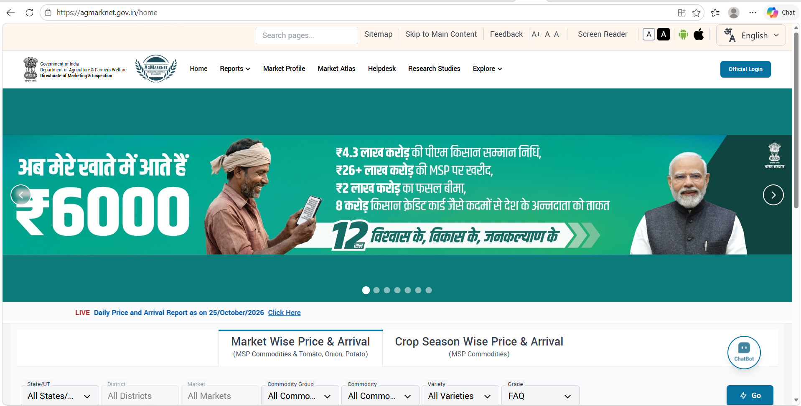

*Figure 20 — External reference: [AGMARKNET](https://agmarknet.gov.in/home) showing the market-wise price and arrival reporting interface.*

#### 9.4 AGMARKNET — portal overview

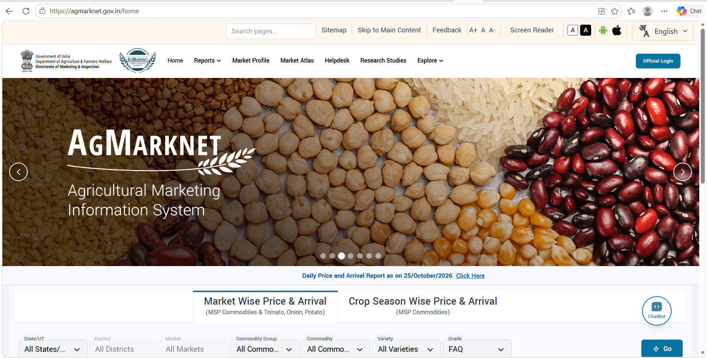

*Figure 21 — External reference: a second view of AGMARKNET's homepage banner and market reporting navigation.*

**Evidence distinction:** Figures 9–17 support the **project functionality and UI presentation**. Figures 18–21 identify **external reference portals**. Figures 2–8 above document GitHub Actions, test execution, build and Docker. To satisfy the faculty's meaningful-change criterion, also record genuine changes and their individual commit IDs with corresponding screenshots.

**Verification note:** The CI screenshots document one inspected successful run. GitHub Actions must be checked again after later commits; the older screenshot is not evidence that new commits also passed. The Docker screenshots represent successful **local** containerization and do not prove a live public deployment.

**Recommended further proof before final ISE-2 submission:** verify that the shown browser screenshots are from the Docker-served app at `http://localhost:8081` if claiming Docker-hosted UI evidence; capture five real before/after website changes, a GitHub commit-history page showing all genuine changes, and a successful CI run for the latest commit. Add them to this section only after the corresponding files and work exist.

---

## 🧾 Five meaningful changes and authentic Git history

### What the faculty requires

The detailed ISE-2 notice dated **17 October 2026** requires **at least five meaningful changes to the website**, committed and pushed to GitHub, and a README with **commit details and corresponding screenshots**. A subsequent message mentions at least **four commits**. Following the stricter interpretation, the safest target is **five distinct, genuine website improvements recorded as commits**, in addition to initial upload and documentation evidence.

The project has an initial source commit, but that single commit contains many existing features. **Features included in the initial upload must not be misrepresented as five separately committed development stages.** The screenshots in the previous section document actual results; they do not create missing Git history.

### Observed Git history (from supplied evidence)

| Verified entry | Commit / evidence | Scope | Status |
| --- | --- | --- | --- |
| Initial source publication | [`15d1db4`](https://github.com/anisaskazi/TechTitan-AgriSphere/commit/15d1db4) | Original repository upload of KrishiMitra ONE application, build scripts, automated tests, CI and Docker configuration | **Observed in GitHub screenshot** |
| Docker integration documentation | `README.md` plus `screenshots/docker-container-running.png` | Screenshots and instructions prepared locally | **Verify separate commit and push in GitHub history** |

[View the authentic, current commit history on GitHub](https://github.com/anisaskazi/TechTitan-AgriSphere/commits/main).

### Five website improvements to implement and document as genuine changes

These are **specific next-change candidates**, not claims that new commits already exist. Make changes to the actual source, test them, commit each change, and insert the real commit hash and screenshot afterward. Avoid duplicate functionality and choose adjustments that genuinely improve the existing code.

| Change | Suggested meaningful improvement | Test / screenshot evidence | Real commit hash |
| --- | --- | --- | --- |
| 1 | Improve crop catalog search/filter accessibility, empty states, or favorites usability | Search/filter interaction before and after; relevant tests | _Add after committing_ |
| 2 | Strengthen soil-input validation and the clarity of pH/N-P-K records | Form error/success behavior screenshot and tests | _Add after committing_ |
| 3 | Improve farm-task and crop-plan usability, including mobile layout or keyboard interaction | Real task/plan workflow screenshot and tests | _Add after committing_ |
| 4 | Improve weather loading/error states and show transparent live-data limitations | Verified offline/error and online states with tests | _Add after committing_ |
| 5 | Improve report/export accessibility, empty-state handling, or verification feedback | Working reports/export screenshot and tests | _Add after committing_ |

**Workflow for every change:** edit source → run locally → test → take a real screenshot → stage only that change → commit with a meaningful description → `git push origin main` → confirm latest CI success → insert its actual short hash and screenshot into this README. Do not backdate commits, fabricate before/after images, or claim that an existing initial-commit feature was added later.

For example, *after genuinely improving the search interaction*:

```bash
npm test
npm run build
git status
git add app.js styles.css tests/
git commit -m "feat: improve crop search accessibility"
git push origin main
git log --oneline -6
```

Adjust the staged filenames to the files you actually changed. Commit messages are descriptions of real work, not targets to manufacture.

---

## 🏅 Academic ISE-2 rubric and submission checklist

**Subject:** DevOps and Kubernetes · **Assessment:** Individual ISE-2 project submission · **Rubric:** 10 marks, according to the supplied faculty notice.

| Criterion | Marks | Where to demonstrate it |
| --- | ---: | --- |
| Project functionality | **3** | Launch the actual website, navigate its modules, and demonstrate working forms/records |
| DevOps implementation | **3** | Dockerfile and healthy Nginx container, GitHub Actions test/build run, real proof screenshots |
| GitHub repository | **2** | Organized directories, source and config files, **authentic meaningful commit history** |
| Documentation | **2** | This README, setup instructions, architecture, source layout, change log, and embedded proof images |
| **Total** | **10** | **Marks are awarded by the evaluator, not guaranteed by a README** |

### Final checks before adding the Google Sheet link

- [x] Project source is organized in GitHub (documented initial upload).
- [x] `README.md` explains the introduction, objectives, features, stack, setup, and project structure.
- [x] Git and GitHub workflow is documented.
- [x] A Dockerfile and GitHub Actions pipeline are present in the supplied source.
- [x] The inspected GitHub Actions run shows **46 tests passed**, successful build, and output verification.
- [x] Docker image build and a healthy local container were demonstrated.
- [x] Genuine DevOps proof screenshots are embedded in this README package.
- [ ] Complete **five meaningful, individual website changes** and push the associated actual commits.
- [ ] Fill in real commit hashes and embed screenshots of each change or before/after result.
- [ ] Confirm GitHub Actions is green for the **latest submitted commit**, not merely the initial upload.
- [ ] Verify all embedded screenshots render correctly on GitHub after pushing the `screenshots/` folder.
- [ ] Perform a final live walkthrough of the site, including Docker-served `http://localhost:8081`.
- [ ] Enter **only this repository URL** in the Google Sheet cell beside your own name: `https://github.com/anisaskazi/TechTitan-AgriSphere`.

### Academic integrity and attribution

Every screenshot must come from the student's real project execution, not from another student's website, development stages, Git history, or Docker execution. The project should be meaningfully distinct in implementation and presentation. Record any externally sourced starter code/assets and permitted AI assistance in accordance with faculty rules. A well-formatted README cannot replace missing source work, commits, or genuine proof.

---

## 🌐 Deployment

### Option A — Static deployment to Netlify

The project supports static hosting. Use the generated `dist/` folder:

```bash
npm run build
```

1. Sign in to [Netlify](https://app.netlify.com/).
2. Create a new site using **Netlify Drop** and upload the generated `dist/` folder, **or** connect the GitHub repository.
3. For Git-connected deployment, use build command `npm run build` and publish directory `dist` (or the provided `netlify.toml`, if the settings match).
4. After publication, manually verify navigation, mobile layout, image paths, local persistence, and online weather requests.
5. Add the actual hosted URL here **only when deployment succeeds**.

**Public demo:** Not yet published / verified.

### Option B — Docker + Nginx

Use the Docker instructions above for a repeatable, locally served deployment. A production hosting environment requires separate domain, HTTPS, networking, monitoring, and operational controls.

## 🌿 Git and version-control workflow

Git is used to document real changes and retain a traceable project history.

```bash
# Review modified and new files
git status

# Stage a specific documented change
git add README.md screenshots/docker-container-running.png

# Create an authentic, descriptive commit
git commit -m "docs: add Docker evidence and deployment instructions"

# Upload the committed change
git push origin main

# Inspect the commit history
git log --oneline
```

### Commit quality standards

- Make **separate, meaningful changes** to functionality, tests, accessibility, performance, documentation, or deployment configuration.
- Test the relevant change before committing.
- Use precise messages such as `feat: improve crop search filters`, `test: cover buyer quote edge cases`, or `docs: add container verification evidence` **only when those changes actually occur**.
- Never fabricate Git history or split one unchanged snapshot into fake development stages.
- Review the GitHub Actions result for each pushed change.

**Academic note:** One genuine initial GitHub commit was visible in the supplied screenshots. For the required additional change history, use the verified entry table and the five-change tracker above. Additional commits should correspond to **real website improvements**, not an invented sequence of work.

## 🔐 Security, data handling, and limitations

Transparency about the application's present capabilities is essential for safe, credible use.

| Area | Current boundary |
| --- | --- |
| Farmer accounts | No verified production authentication / per-user cloud accounts |
| Database | Records are stored in the **current browser's localStorage**, not a synchronized backend database |
| Multi-device use | Data does not automatically follow the farmer to another device |
| Crop recommendations | Crop-fit comparisons are **rule-based** and have not been validated as agronomic predictions |
| Crop health | Photos and notes are journaling tools, **not trained AI disease detection** |
| Yield | Illustrated using user inputs, **not a trained forecast model** |
| Marketplace | Listing drafts and manually entered buyer quotations; **no live purchasing, verified network, or payment processing** |
| Mandi prices | No automatic verified live mandi-price feed is claimed |
| Weather | Internet-dependent Open-Meteo service with service availability and applicable terms |
| Offline use | Selected static assets may be cached; live third-party data is not guaranteed offline |
| Localization | Multilingual support is partial and requires further validation |
| Data safety | Clearing browser storage may delete records; use export/backup with caution |

**Do not store sensitive personal, financial, or regulated information in this demonstration release.** Crop-choice, fertilizer, pesticide, and disease decisions should be checked with an appropriately qualified local agricultural professional.

## 🛣 Production roadmap

These are **planned improvements**, not capabilities already delivered:

**Phase 1 — Real farmer validation**

- Conduct usability trials across regional languages, device sizes, and low-bandwidth conditions.
- Verify crop calendars and advisory logic with agronomy experts.
- Improve keyboard access, contrast, form validation, and assistive-technology usability.

**Phase 2 — Secure cloud platform**

- Implement authenticated accounts, explicit consent, server-side authorization, and cloud storage with backups.
- Introduce secure multi-device synchronization and audit logging.
- Add operational monitoring, automated deployment, and vulnerability management.

**Phase 3 — Verified intelligence and integrations**

- Integrate licensed and timestamped market-price information from trusted sources.
- Evaluate independently validated ML models using representative local agricultural datasets.
- Add expert review and safe escalation before any disease or agronomic guidance reaches real users.
- Explore real alerts, logistics features, and marketplace workflows subject to legal and security review.

## 🎓 Academic learning outcomes

This project demonstrates how a real-world problem can be expressed as a usable web application and delivered through basic software engineering and DevOps practices:

1. **Problem analysis:** translating fragmented agricultural workflows into structured product modules.
2. **Frontend engineering:** responsive pages, reusable rules, form interactions, and state handling.
3. **Automated quality assurance:** a repeatable Node.js test suite (46 passing tests in the recorded CI run).
4. **Version control:** Git commits, remote repository management, and change traceability.
5. **Continuous integration:** automated test, build, and output verification with GitHub Actions.
6. **Containerization:** multi-stage Docker packaging and Nginx serving with an observed healthy container.
7. **Deployment literacy:** the distinction between source code, generated build artifacts, local Docker execution, and a public production release.
8. **Responsible engineering:** documented capability boundaries, data handling concerns, and a staged production roadmap.

**Suggested assessment demonstration:** Show the source repository → show authentic commit history with five meaningful changes → open the latest successful CI run → display the 46-test summary → demonstrate successful build → show Docker Desktop or `docker ps` with the healthy container → open the application at `localhost:8081` → navigate through representative farm workflows.

## 👩‍💻 Repository maintainer

**GitHub repository owner:** [@anisaskazi](https://github.com/anisaskazi)

**Project repository:** [TechTitan-AgriSphere](https://github.com/anisaskazi/TechTitan-AgriSphere)

---

## ✅ Conclusion

**TechTitan-AgriSphere (KrishiMitra ONE)** demonstrates how a practical agricultural problem can be addressed through a responsive web application supported by core DevOps practices. The project brings crop exploration and farm-record workflows—soil observations, crop planning, field tasks, crop-health journaling, harvest, buyer quotations, storage, and finances—into a single interface. The weather feature connects to Open-Meteo when online, while official agriculture portals are provided as references for further verification.

From a software engineering perspective, the project demonstrates an organized GitHub repository, automated application checks, a repeatable production build, and containerization with **Docker and Nginx**. The supplied execution evidence records **46 passing automated tests with zero failures**, a successful `npm run build`, a successful Docker image build, and a locally running **healthy container on port 8081**. GitHub Actions automates test and build verification. Screenshots and configuration details are included so these outcomes can be reviewed and reproduced.

The work has also highlighted important engineering responsibilities: maintaining accurate version-control history, recording real test results, distinguishing a development prototype from production software, and handling farm information responsibly. Browser-local storage, the rule-based crop-fit advisor, and the absence of cloud accounts or validated AI disease diagnosis remain deliberate and clearly stated current limitations. Future work can introduce authenticated cloud synchronization, field validation, accessible multilingual experiences, and expert-reviewed or independently evaluated agricultural intelligence.

**Overall, the project provides a functional educational agricultural platform and a documented DevOps workflow, while defining a realistic path toward more dependable, scalable farm-management software.** Its final ISE-2 submission should be accompanied by a verified latest CI run and authentic evidence of the faculty-required meaningful website changes and their associated commits.
